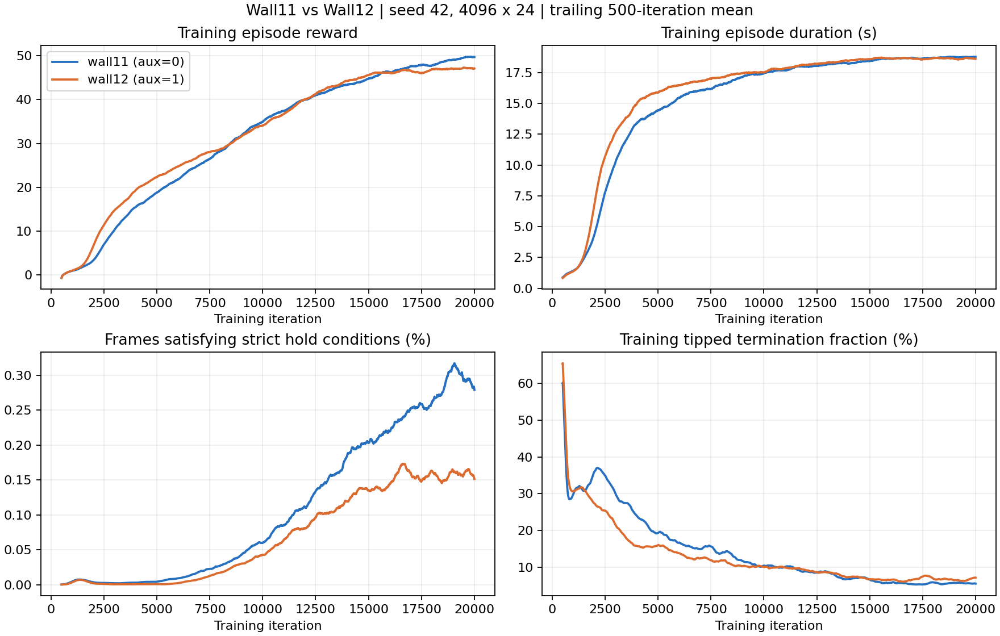

# wall11 / wall12：aux监督工程对比

两组均为seed42、4096环境×24步、5×4更新、20000轮，最终model19999。Checkpoint环境契约仅variant/parent/pose_supervision不同；agent配置仅名称、runner/PPO类、aux系数不同；AMP数据及其他AMP目标一致。wall11包含兼容pose head结构但冻结且aux=0，wall12解冻并以coef1更新共享CNN；回归预测均不直接反馈actor。

训练末1000轮的日志均值：

| 指标 | wall11 aux=0 | wall12 aux=1 |
|---|---:|---:|
| 训练回合回报 | 49.651 | 47.198 |
| 回合时长/s | 18.780 | 18.648 |
| 每步原始任务奖励 | 0.052870 | 0.050603 |
| carryup奖励日志 | 1.671140 | 1.589702 |
| standup奖励日志 | 0.011328 | 0.009447 |
| 满足严格保持条件的瞬时帧占比/% | 0.2866 | 0.1547 |
| 倾倒终止比例/% | 5.655 | 6.804 |

日志`Task/*success_fraction`为进程启动以来的累计成功率，不是当前策略成功率；两组训练全程该严格连续2秒成功指标均为0。训练采用采样动作，独立回放采用均值动作，二者不可混为同一分布。训练回报来自环境原始任务奖励；AMP奖励另外记录。

统计窗口为19000–19999；Train/*为每轮记录的最近100个结束回合滚动均值，再取1000轮均值，并非回合等权总体估计。Episode_Reward与Termination保留原日志归约口径。每轮采样+学习耗时末1000轮均值wall11 4.070秒、wall12 4.136秒，约+1.6%；这是不同时间run的观测耗时，不是隔离系统负载的开销实验。

最终工程判断：**有局部改善，尚未改善完整“搬起后稳定站住”任务。** wall12前期训练更快延长回合，最终均值动作回放短时持箱更常见、倾倒更少；但严格站稳2秒成功回合数更低，末段训练回报也更低。不能简单说aux完全无效，也不能把这版认定为任务成功率改进。

两个最终model19999分别以seed12345、67890，各64环境回放最多20秒，合计各128个首回合。其中各100个地面箱起点（26默认站姿、74 loco RSI），28个参考空中箱起点单列，绝不混入地面拾箱成功分母。机器人/箱体/障碍位姿、关节、尺寸、质量/惯量/COM/摩擦、初始本体/深度观测和CPU/CUDA RNG逐项配对，最大差异0。保留原噪声、实体墙柱、控制、扰动、随机化、终止与reset；均值动作，不更新任何参数。策略终止时间不同会改变后续随机数调用顺序，因此保证配对初态及初始RNG，不声称后续逐帧噪声相同。

| 地面起点首回合指标（每组100回合） | wall11 aux=0 | wall12 aux=1 |
|---|---:|---:|
| 曾双手持箱离地，至少1控制帧 | 65/100 | 63/100 |
| 连续双手持箱至少0.5秒 | 19/100 | 30/100 |
| 严格满足全部条件连续2秒成功 | 9/100 | 6/100 |
| 平均每回合累计持箱时间 | 2.185秒 | 2.681秒 |
| 平均每回合最长连续持箱时间 | 1.717秒 | 1.682秒 |
| 平均每回合最长严格保持时间 | 0.799秒 | 0.424秒 |
| 倾倒终止 | 6/100 | 1/100 |
| 所有失败终止 | 7/100 | 6/100 |
| 正常20秒超时 | 93/100 | 94/100 |

持箱要求双手箱体接触均>1N、箱底离地>0.1m、箱体竖直分量>0.8。0.5秒指标要求连续25控制帧；单帧离地只作宽松诊断。严格成功直接读取任务内部achieved并以最长连续100帧计数交叉核对：另需箱心≥0.7m、机器人竖直>0.95、头高>1.05m、机器人水平速度<0.15m/s、偏航角速度<0.3rad/s、箱速<0.15m/s、箱子水平漂移<0.35m，连续2秒。成功判定不终止回合。

只有首回合计入，终止/reset前抓取最后一帧，自动reset后的新回合不计。非终止回合统计到20秒，未按好坏筛选环境。累计持箱时间允许断续，不能等同连续站稳时间。

分种子结果：seed12345的50个地面起点，持续持箱10→13，严格成功6→4；seed67890的50个地面起点，持续持箱9→17，严格成功3→2。逐对统计：持续持箱两者均达到9对、仅wall11达到10对、仅wall12达到21对；严格成功两者均达到2对、仅wall11达到7对、仅wall12达到4对。倾倒减少不等于所有失败同比减少：总失败7→6，wall12另有其他高度/箱速等终止条件，这里不进一步拆分归因。

28个参考空中起点：持续持箱17→15，严格成功6→4，平均累计持箱6.392→4.884秒。此组只能说明参考起点后的保持表现，不是从地面搬起。

已有[wall12回归诊断](../wall12_pose_eval_20261026/README.md)显示，箱心平均误差5.63cm（持箱时3.84cm），对称折叠旋转误差仍约58.10°。训练末1000轮位置MSE0.010845、旋转MSE0.205815。这说明位置监督有学习效果，但旋转仍弱；不能单凭这个回归误差推断动作任务收益，也未证明旋转loss导致稳定性下降。wall11的兼容头未训练，不对其随机输出计算“回归精度改善倍数”。

训练时aux只通过共享CNN梯度影响策略表征，回归结果不直接输入actor；play时不调用head也不会移除训练已形成的表征影响。因此本次对比两个独立训练策略，不能用同一wall12 checkpoint在play时开关head替代。

两组各只有一次seed42正式训练，本次两个评估seed也不是两个训练seed。结果是这两个最终checkpoint的工程比较，不构成多seed普遍因果结论；9/100与6/100等小样本差异不声称统计显著。训练采用带动作采样的策略，回放采用均值动作；训练严格成功累计为0与回放出现严格成功并不矛盾。

三条冻结检查均PASS：[receipts.json](receipts.json)。配置/模型哈希与完整训练统计：[training.json](training.json)；曲线原始值：[curves.npz](curves.npz)；配对校验及分组汇总：[comparison.json](comparison.json)；逐首回合记录：[episodes.json](episodes.json)。4组*_initial.pt保存配对初态；各组JSON/log保留原始诊断。已查看曲线图片，内容和标签正常。

本次仅新增诊断脚本/记录及项目进度，不修改生产代码、数据或checkpoint，不启动训练，不停止既有足球进程。
