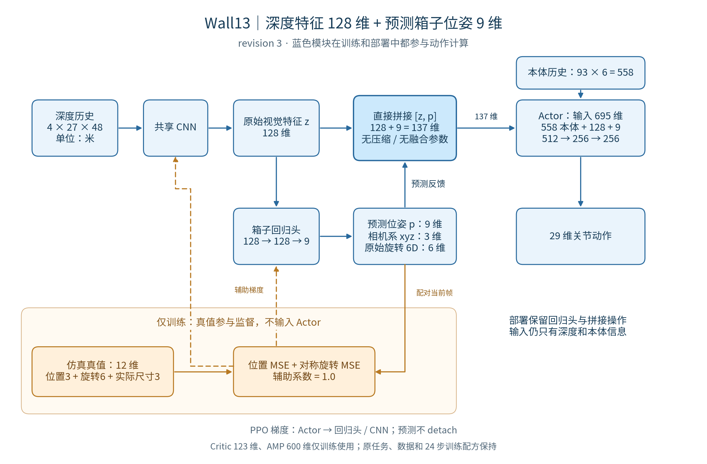

# wall13 revision 3：直接拼接预测位姿，并启动正式训练

2026-10-26。用户选择“直接拼接9维，再启动训练”。当前任务 ID 保持 `Template-Perceptual-Ball-CarryBox-Walled13-v0`。

## 网络实现



[PNG](architecture.png) · [SVG](architecture.svg) · [Mermaid](architecture.mmd)。可用 `/home/cao/ENTER/envs/ball/bin/python docs/carrybox/wall13_concat_20261026/draw_diagram.py` 重画 PNG/SVG。

```text
z = CNN(depth_history)                  # 深度4×27×48米制 → 128维
p = pose_head(z)                        # 128→128→9：相机系xyz3 + 原始旋转6D
features = concat(proprio, z, p)         # 558 + 128 + 9 = 695维
action = Actor(features)                # 695→512→256→256→29
```

顺序明确为 `[本体558, 原始深度特征128, 预测位姿9]`，Actor入口保留完整的9维预测。移除 revision2 的 `Linear137→128 + ELU`；为沿用已验证的共享导出器接口，`box_pose_fusion` 属性仅保留无参数的 `Identity`，不会进行压缩或非线性变换，模型/优化器/ONNX中均无融合层参数。相较 revision2，删除17,664个融合参数，Actor首层增加4,608个参数，合计减少13,056个参数。

预测位姿前三维为箱心在相机光学系的位置（右x、下y、前z，单位米），后六维为旋转矩阵前两列的原始连续输出。尺寸不作为预测输出，也不进入Actor。

不对预测值 `detach`：PPO及策略时间平滑梯度经过回归头进入CNN；辅助监督仍直接训练回归头和CNN，不进入Actor MLP。标签保持wall12的同步12维相机系位置3、旋转6、实际尺寸3，损失保持位置MSE＋尺寸对称旋转MSE、系数1.0。实际尺寸只参与等价旋转判定。Critic仍独立使用123维特权状态，AMP仍为600维；标签、Critic和AMP信息均不进入Actor。

采样、PPO current/mixed、play和部署顺序一致。学习时两组深度合批进行一次CNN前向，各自预测自己的位姿；只缓存current预测做辅助监督，仍保持每轮20次minibatch更新、20次CNN调用。

JIT/ONNX外部输入保持本体 `flat` 558维与 `depth` 4×27×48，输出29维动作；回归头保留在部署模型中。本次生产代码仅改四个wall13文件，共享CNN/AMP、父类监督、export及train/play未改。

## 保持的任务与训练设置

接近箱子、抬起后原地稳定保持2秒；噪声深度、三圆柱与墙壁、奖励、控制、物理随机化及RSI保持。AMP继续使用canonical `assets/motions/findbox/` revision3的11行走/3拾箱/1静止持箱，静止片段第20帧后固定姿态、速度为零。这份数据与wall12已经使用的数据相同，本次未换数据内容、权重或manifest。

正式配置保持4096环境、24步rollout、5 epochs × 4 minibatches、20000轮、seed42、aux1.0、每500轮保存。当前是从零训练，无resume或warm-start。

环境 `migration_revision=3`，反馈契约 schema2、output137、Actor输入695、`fusion=concat_only`；学习器AMP schema仍为13，其中反馈契约与环境一致。旧wall13 revision1/revision2及wall12 checkpoint严格恢复会被拒绝；没有隐式权重迁移。历史记录见[revision2融合方案](../wall13_feedback_20261026/README.md)和[revision1数据入口](../wall13_20261026/README.md)。

## 验证

60项CPU检查通过，覆盖695维逐段内容与顺序、预测干预改变动作、特权隔离、梯度边界、当前/混合前向一致、优化器参数完整与精确恢复、旧版本/篡改契约拒绝，以及wall11/12和足球导出兼容。

16环境、24步采样、2轮更新后保存并严格恢复，再更新1轮，共60次优化步骤通过。Actor、Critic、CNN、回归头和AMP实际更新且有限，Adam状态/学习率恢复完全一致；CNN调用仍为每轮20次。模型、Adam与导出均无融合参数。

动态batch=1/16的JIT/ONNX检查通过，ONNX最大绝对误差分别为1.34e−7、1.64e−7。短测中预测位置加1m导致动作最大变化0.00938，只说明反馈路径有效，不是位姿精度或任务效果结论。短测模型仅存本目录，不能作为正式训练成果。

检查命令：

```bash
bash docs/carrybox/wall13_concat_20261026/validate_cpu.sh
bash docs/carrybox/wall13_concat_20261026/validate_sim.sh
bash docs/carrybox/wall13_concat_20261026/check_training.sh
```

第三条仅只读等待已记录的唯一启动身份并验收健康状态，不启动或重启训练。正式长训运行时不要直接重跑第二条GPU短测，应先核对显存。检查证据：[CPU日志](cpu.log)、[短测结果](smoke.json)、[短测日志](smoke.log)、[冻结测试回执](receipts.json)、[正式健康检查](health.json)。

## 正式启动记录

启动前重新核对，无kickball或其他正式训练进程，可用显存23,136MiB。因此没有发送停止信号；历史足球日志和最新发现的model7500均保留，退出原因未调查。见[停止/进程核对记录](stop_state.json)、[启动身份](launch.json)、[源码哈希](tested_source_identity.json)。

2026-10-26 20:51:09 JST启动，PID **3980527**，从零训练命令：

```bash
cd /home/cao/perceptual_ball
CARRYBOX_VARIANT=13 bash scripts/rsl_rl/train_carrybox_walled.sh \
  agent.num_steps_per_env=24 --num_envs 4096 --max_iterations 20000 \
  --seed 42 --run_name wall13_24step_pose_concat9_fresh_20261026_205109
```

查看正在训练的日志：

```bash
tail -f /home/cao/perceptual_ball/logs/rsl_rl/g1_carrybox_depth/walled13/train_wall13_24step_pose_concat9_fresh_20261026_205109.log
```

工程记录：`agent/{plan,task,report,handoff}/carrybox-wall13-concat-20261026.md`。正式训练正在进行，未完成20000轮，未做任务成功率或实机评估。
