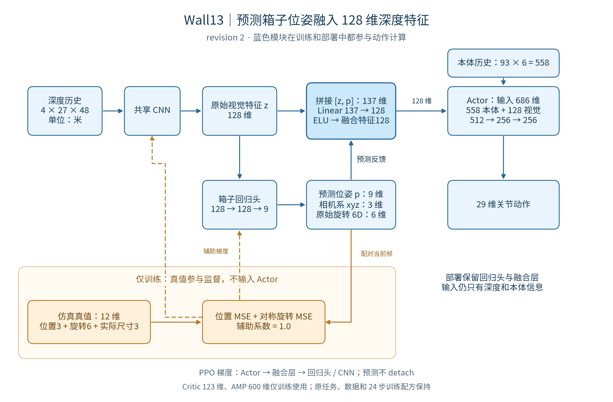

# wall13 revision 2：箱子预测位姿融入 128 维深度特征

此页保留 **revision2融合方案的历史记录**。用户随后选择直接拼接9维并启动训练，当前为[revision3：Actor输入695维](../wall13_concat_20261026/README.md)。本页结构图、测试和“未启动正式训练”描述均对应当时的revision2。

2026-10-26。实现、CPU 检查、16 环境更新/恢复及 JIT/ONNX 导出检查完成。未启动正式训练，尚无收敛、任务成功率或实机效果结论。

独立任务 ID 仍为 `Template-Perceptual-Ball-CarryBox-Walled13-v0`。本次在 wall13 加入预测反馈，不改 wall11/wall12 的网络行为。



说明图：[PNG](architecture.png)、[矢量 SVG](architecture.svg)、[Mermaid 源码](architecture.mmd)。可用 `/home/cao/ENTER/envs/ball/bin/python docs/carrybox/wall13_feedback_20261026/draw_diagram.py` 重新生成 PNG/SVG。

## 前向计算：保持 128 维视觉输出

```text
深度历史 D：4 × 27 × 48，单位米
z = CNN(D)                                     # 128 维原始深度特征
p = pose_head(z)                               # 9 维预测位姿
v = ELU(Linear(concat(z, p)))                    # 137 → 128 维融合特征
action = Actor(concat(proprio_history, v))       # 558 + 128 = 686 → 29
```

回归头沿用 `128 → 128 → 9`：前三维是箱心在相机光学坐标系中的 xyz，单位米；后六维是旋转矩阵前两列的连续表示。相机坐标轴为右 x、下 y、前 z。融合使用网络输出的原始六维旋转表示，不先正交化，也不把它称为三个欧拉角。

新增融合层为 `Linear(137, 128) + ELU`，共 17,664 个参数。Actor 保持 `686 → 512 → 256 → 256 → 29`，本体历史仍是 `93 × 6 = 558` 维。128 维输出的每一维都可以混合原始视觉与预测位姿；没有人为指定其中九维为固定语义槽。

因此，预测信息现在有一条显式影响动作的计算路径。是否学会有效利用它，仍需正式训练和评估验证。

## 监督与梯度

沿用 wall12 的同步标签、对称处理及损失：

- 标签 12 维：相机系位置 3、旋转 6、当前箱子的实际尺寸 3。尺寸仅用于确定等价旋转，不是回归输出，也不进入 Actor。
- 辅助损失为位置 MSE 加尺寸保持对称下的最小旋转 6D MSE，系数仍为 1.0。沿用所有当前配对帧，不按可见性筛选；原有时间平滑更新使用 rollout 的前 T−1 帧，24 步时每个环境有 23 个 current 样本。
- PPO 和策略时间平滑的梯度通过融合层进入回归头与 CNN，预测值不 `detach`。辅助损失直接更新回归头和 CNN，不更新融合层或 Actor MLP。
- 独立 Critic 仍接收 123 维特权状态，AMP 仍为 600 维；它们及仿真标签不进入 Actor。Critic 损失不更新视觉分支。
- 复用原联合 Adam；融合参数在优化器创建前注册，回归头沿用父类解冻并只加入一次，三个参数组无遗漏或重复。

采样、play、PPO current/mixed 两组输入及部署使用相同的预测和融合逻辑。学习时 current 与 mixed 各用自己的深度预测位姿；合并为一次 2N CNN 前向，再分别计算动作。仅缓存 current 的预测用于辅助监督，每轮 20 次 minibatch 更新仍只调用 20 次 CNN，没有额外重复编码。

## 与 wall12 / 原 wall13 的区别

| 项目 | wall12 / wall13 revision 1 | wall13 revision 2 |
|---|---|---|
| Actor 的视觉特征 | CNN 原始 128 维 | CNN128 与预测位姿9融合后的128维 |
| 回归头用途 | 辅助监督 CNN | 辅助监督，并参与动作计算 |
| PPO 是否经过回归头 | 否 | 是，无 detach |
| 部署保留模块 | CNN、Actor | CNN、回归头、融合层、Actor |
| Actor 外部输入 | 本体与深度 | 本体与深度，保持不变 |
| 辅助标签与损失 | 相机系位姿、尺寸对称、coef1.0 | 保持不变 |

环境与训练配方保持：接近箱子、抬起并原地稳定保持 2 秒，深度噪声、三圆柱与墙壁、奖励、物理随机化、RSI、4096 环境 × 24 步、5 epochs × 4 minibatches 均不变。

AMP 仍显式使用 `assets/motions/findbox/` revision 3，11 段行走、3 段拾箱、1 段静止持箱。静止片段从第 20 帧后固定姿态、速度为零。该数据和 wall12 正式训练的数据相同，本次没有改动数据或采样权重。历史数据核验见[原 wall13 记录](../wall13_20261026/README.md)。

## 部署与 checkpoint

JIT/ONNX 输入仍仅为 `flat` 本体 558 维及 `depth` 深度 4×27×48，输出仍为 29 维动作。导出模型保留有效的 `pose_head` 和 `box_pose_fusion`，不包含 Critic、AMP 或真值标签。共享导出器只在 wall13 的 box feedback 标志启用时增加这两层；旧搬箱任务及足球导出路径已做回归检查。

环境 `migration_revision` 升为 2，AMP 学习契约为 schema 13，环境和学习器都记录 `actor_feedback=True` 与 137→128 融合约定。旧 wall13 revision 1 和 wall12 checkpoint 不能严格恢复到新结构；也未实现旧权重的部分迁移。正式使用本结构应从零训练。不要用本目录的短测模型作为已训练策略。

正式训练命令（本次未执行）：

```bash
cd /home/cao/perceptual_ball
CARRYBOX_VARIANT=13 bash scripts/rsl_rl/train_carrybox_walled.sh
```

正式日志仍写入 `logs/rsl_rl/g1_carrybox_depth/walled13/`，默认 run 名为 `wall13_pose_feedback128_v2`。新模型训练后回放：

```bash
CARRYBOX_VARIANT=13 bash scripts/rsl_rl/play_carrybox_walled.sh /absolute/path/to/wall13_revision2/model_N.pt 4
```

## 验证证据

两条冻结检查均 PASS，见 [receipts.json](receipts.json)、[cpu.log](cpu.log)、[smoke.json](smoke.json)、[smoke.log](smoke.log)：

```bash
bash docs/carrybox/wall13_feedback_20261026/validate_cpu.sh
bash docs/carrybox/wall13_feedback_20261026/validate_sim.sh
```

CPU 共 60 项检查，包括位姿干预确实改变动作、特权输入隔离、梯度边界、current/mixed 路径一致、优化器参数完整与恢复、旧 checkpoint 拒绝，以及 wall11/wall12/足球导出兼容。

16 环境仿真完成 24 步采样、2 轮更新后保存、严格恢复后再更新 1 轮，共 60 次优化步骤。CNN、回归头、融合层、Actor、Critic、AMP 均实际更新且有限；Adam 状态和学习率严格恢复。环境配置对 wall12 仅 variant 有差异，runner 仅类名和日志命名有差异。强制部分环境超时的记录与终止处理通过。

短测模型将预测位置增加 1 m 后，动作最大变化 0.0067006；这验证显式反馈路径有效，不代表预测准确或任务性能提高。JIT/ONNX 动态 batch=1/16 与原策略一致，ONNX 最大绝对误差分别为 8.94e−8 / 1.19e−7。未测试正式 4096 环境每轮耗时，不能据此承诺 4 秒。

第一次仿真检查在训练后的导出对照阶段，因验证脚本深拷贝含非叶张量的临时策略分布而失败。已改成新建 CPU 策略并加载相同权重，保留原断言，两条检查重新执行通过；生产代码未因这个问题改动。失败脚本、日志和回执保留在 [attempt1](attempt1/)。

本次未操作任何正式训练进程。结束时的实际进程与文件哈希见 [final_state.json](final_state.json)，四份工程工件交叉校验见 [artifact_validation.json](artifact_validation.json)。完整代码入口：[wall13 学习器](../../../source/perceptual_ball/perceptual_ball/rsl_rl_extensions/carrybox_wall13.py)、[配置](../../../source/perceptual_ball/perceptual_ball/tasks/manager_based/perceptual_ball/carrybox_wall13_env_cfg.py)、[导出器](../../../source/perceptual_ball/perceptual_ball/rsl_rl_extensions/export.py)。
