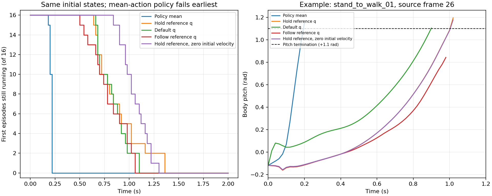

# wall5 model11200：空手行走起点立即倾倒诊断

2026-10-19。结论：**该 checkpoint 没有学会从 loco 起点稳定站立、行走。策略第一步给出过大的伸膝目标，明显加速了前倾；整体回合长度被长时间持箱 RSI 回合掩盖。** 这是诊断完成，不是学习问题已修复。

目标是正式 run `2026-10-19_00-37-11_wall5_v14_asymmetric_fresh_20261019_003706/model_11200.pt`，SHA256 `05e97532bc898b95873afd744c6511b3c0ce7678f8779317697b4c20f9d900f0`。严格加载原 revision14 环境契约和全部网络权重，使用[归档配置](../wall5_push_20261019/before/source/perceptual_ball/perceptual_ball/tasks/manager_based/perceptual_ball/carrybox_wall5_env_cfg.py)。当前生产源码 revision15 的增量推扰/摩擦更改不混入本回放。

## 直接证据

16 个相同初态、每组 100 个 policy 步（50Hz），每条件独立启动仿真。仅诊断强制 loco 起点；生产 RSI 80/0/20 不变。参考初始化真实 clip/frame、root link/COM 速度、关节状态、箱子/墙/圆柱、相机、actor 本体和深度观察均比较一致；观测断言保持 atol/rtol=1e-5。清初速组在一致性核对后显式清零机体六维速度及全部关节速度，并回读 PhysX。

| 同一初态的动作控制 | 首回合平均步数 | 范围 | 20步后仍存活 | 首回合受过push |
|---|---:|---:|---:|---:|
| checkpoint 均值动作 | **10.56（0.211秒）** | 9–11 | **0/16** | 0/16 |
| 保持初始化参考关节角 | 44.56 | 32–68 | 16/16 | 1/16 |
| 目标切为默认关节角 | 41.81 | 33–55 | 16/16 | 0/16 |
| 按原片段推进参考关节角 | 40.00 | 25–53 | 16/16 | 0/16 |
| 保持参考角、清初始速度 | 52.94 | 42–65 | 16/16 | 1/16 |

所有组的16个首回合均在100步内结束，无截尾样本。推扰保留原实现并记录时机；前20步所有条件均未推扰。后续 reset 后的轨迹不纳入本表。



1. **reset 由真实倾倒触发。** 策略组16/16首回合 pitch 超过1.1rad（约63°），发生于首次推扰前；不是箱子消失或未抱箱触发reset。初始 pitch 为−0.228～−0.105rad，没有初始 tipped/fell；最低足部碰撞点均离地约5mm，没有重现脚底初始化穿地。
2. **动作已经失常。** 首步左膝16/16、右膝14/16请求目标超出物理下限；均值如下。双膝被驱向伸直/轻微反弓限位，踝和腰同时变化。同初态换控制，20步内全部存活，支持“策略输出明显加速失稳”，但这不是单独膝关节干预，不能声称仅膝关节就是唯一原因。

| 关节 | 初始角均值 rad | 限位前请求 rad | 实际目标均值 rad | 物理限位裁剪 |
|---|---:|---:|---:|---:|
| 左膝 | 0.205 | −0.755 | −0.0873 | 16/16 |
| 右膝 | 0.363 | −0.653 | −0.0793 | 14/16 |
| 左踝pitch | −0.158 | −0.364 | −0.364 | 0/16 |
| 右踝pitch | −0.188 | −0.275 | −0.275 | 0/16 |
| 腰pitch | 0.269 | 0.338 | 0.338 | 0/16 |

动作链为策略输出 → wrapper ±9裁剪 → `q_target=0.25*action+随机化默认角` → 物理关节限位 → PD。保持参考角对照用同一处理链逆算 action，不绕过PD、碰撞或限位。参考 q/qdot 与按实际关节名映射后的源帧一致，且 PhysX 回读一致。

3. **RSI 回合比例不等于训练步数比例。** 正式日志11055–11304轮，累计计数差分得到 loco 平均约10.60步、hold约936.38步；已完成回合的步数份额约4.3%/95.7%，loco成功增量0。虽然80% reset选择loco，它们很快结束，而20% hold会长时间占用环境。整体 `mean_episode_length≈200.87` 不代表学会行走。这些是经rollout平均并四舍五入后的累计日志差分估计，不是精确逐步训练buffer计数。
4. **不能再沿用旧版“AMP占80%”解释。** 同期加权task每步约0.06319、AMP约0.002586，AMP约占净混合奖励3.93%；辅助位置loss约0.00209。双膝策略标准差为2.718个action单位（缩放后约0.680rad），也不支持当前“探索太少”的推断；本次均值动作回放不采样，因此加噪不是9–11步倾倒的必要条件。当前训练全关节目标裁剪比例约29.34%。

## reset 与奖励尺度

wall5终止是 `abs(roll)>0.8`、`abs(pitch)>1.1`、root高度<0.2m、头部COM高度<0.4m或20s超时。成功/箱子不可见没有独立立即reset条件。回合结束后按80% loco / 0% pickup / 20% hold重置；画面切到抱箱姿态是参考初始化，不能计作完成地面拾箱。

`early_failure` 的配置权重是−10，但manager乘0.02s后是每次失败−0.2原始task，再乘task混合系数0.75是−0.15；不是每次−10。策略组首回合原始task总回报平均−0.2965：walk约+0.2417，action_rate约−0.1607、torques约−0.1015、early_failure−0.2等。默认角对照原始task回报约+0.541。这里未加载判别器，不能把诊断task回报写成总混合回报。

当前walk奖励远处仍有朝箱速度和方向项，不是“站着一定零奖励”；standup项则要求箱子抬高等成功条件，不能承担空手起点的直立学习。分技能训练样本失衡、控制饱和及任务阶段回报需要一起审计，现有证据不能证明策略有意通过死亡刷hold。

## 尚未排除的控制/数据问题与后续修复顺序

参考保持、默认角及参考轨迹对照均不能稳定跑满2s；**不能宣称初始化和G1控制适配完全正常，也不能把开环参考跟踪失败直接等同数据不可实现。** loco从运动中间帧起步，带非零机体/关节初速；静态保持一个步态帧本来就不是平衡控制器。参考轨迹按源60Hz到policy50Hz的下一时刻线性插值，仅跟关节角，没有闭环root/足端平衡反馈。3个环境在首终止前到达片段末尾后保持末帧，排除这3个后其余13个平均39.15步，同样不稳。

应优先：

1. 检查G1参考初态、关节目标/速度、PD与足端支撑的闭环可跟踪性，先建立能持续站立和移动的loco基线；记录分技能存活、前倾、动作限位和接地，而不是只看总回合长度。源数据的base_height与base_position.z差异是待核对项，本次没有证明它是主因。
2. 让loco获得有保障的实际训练步数，例如独立行走阶段或按技能分配环境。保留用户现有80/0/20直到另行实施具体课程设计，不能把“80% reset”当作已经满足80%行走训练量。
3. 在稳定行走基线上接回拾箱/hold，核对膝动作饱和和失败奖励尺度。revision15推扰与摩擦已单独短测，但不能据此保证修复首次push前就发生的倾倒。不要仅放宽pitch终止来掩盖问题。

本次没有修改生产控制、奖励、RSI、AMP、网络、数据或模型，也没有停止/启动正式训练。检查时原PID4038923已退出，正式日志最后完成11304轮；退出原因未知。当前生产revision15尚未正式训练，未证明拾箱收敛。

## 复现与证据

已执行的冻结检查均PASS：

```bash
bash docs/carrybox/wall5_loco_early_20261019/check.sh
bash docs/carrybox/wall5_loco_early_20261019/replay.sh
```

第二条会运行5个独立的16环境短回放，应在有足够空闲GPU时执行，不是训练命令。结果见[CPU/log审计](training_audit.json)、[简要汇总](summary.json)、[完整回放](replay_result.json)、[CPU回执](receipts_cpu.json)、[GPU回执](receipts_replay.json)。绘图仅从已有结果读取：`/home/cao/ENTER/envs/ball/bin/python docs/carrybox/wall5_loco_early_20261019/summarize.py`。

最初复用单个仿真进程的条件间，物理初态一致但深度观察有约0.18mm差异，严格断言未通过；第一次修复补异常可见性，第二次改为每条件全新进程后通过。断言未放宽、观察未覆盖，原失败日志/脚本/回执以`.attempt1/.attempt2`保存；`exception.txt`为第二次旧失败的保留证据，最终状态以最新回执和5个`case_*.json`为准。
