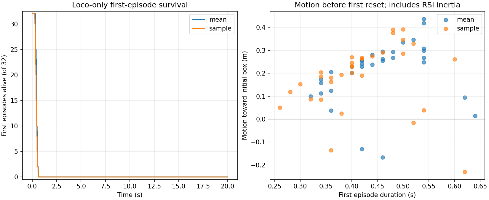

# wall5 roll0.5：model5200空手站走检查

2026-10-19。**本次检查的model5200没有学会稳定站立、走路。** 两种动作模式各32个loco首回合，全部在1秒内因倾倒触发reset；64例均发生在第一次推扰之前。

20:09:27 JST锁定当时最新已完整落盘的checkpoint：

`logs/rsl_rl/g1_carrybox_depth/walled5/2026-10-19_14-25-38_wall5_v15_roll05_fresh_20261019_142533/model_5200.pt`

SHA256：`9b812a21b6f76444825239f3688de5a8956959539dc6c56073984f38a7126cdc`。训练在检查期间继续产生了model5400；本报告只评价锁定的model5200，不将结果冒充新文件的回放结果。实际时间及当前进程快照见[finish_snapshot.json](finish_snapshot.json)。

## 回放结果

| 动作方式 | 首回合数 | 平均存活 | 首次倾倒范围 | 撑过1/5/10/20秒 | 首次push前结束 |
|---|---:|---:|---:|---|---:|
| 均值动作，与常规play一致 | 32 | 22.69步，0.454秒 | 0.32–0.64秒 | 均为0/32 | 32/32 |
| checkpoint标准差采样，训练式动作 | 32 | 21.00步，0.420秒 | 0.26–0.62秒 | 均为0/32 | 32/32 |

这里的结束全部是`tipped`，`fell`高度条件、invalid、timeout均为0，没有右删失样本。均值组中仅roll超限12例、仅pitch超限13例、两者同时超限7例；采样组分别为12、16、4例。当前阈值为abs(roll)>0.5和abs(pitch)>1.1rad。不能把所有失败都归因于roll变严，也不能把未发生的push当作这次快速失稳的直接触发。

均值组首次回合XY位移中位数约0.268m，朝初始箱子方向的位移约0.245m；采样组分别约0.250m和0.203m。但源运动RSI保留初始速度，位移包含初始化惯性及倾倒过程，且所有回合均未撑过1秒，不能将这段移动称为稳定行走。记录了足端轨迹、接触和相对机体移动，见原始回放及summary中的`foot_evidence`，未据此宣称形成稳定步态。

## 为什么训练总回合长度看起来变长

正式日志5165–5414轮的250轮窗口内，总mean_episode_length平均约158.4步。对累计完成回合计数及步数差分后：

- loco平均约19.71步（0.394秒），拾箱成功增量0。
- hold平均约700.05步（14.00秒），成功增量0。
- 已完成回合步数约10.1%来自loco、89.9%来自hold。

所以总回合长度被持箱参考起点显著拉高，不能代表空手行走学会了。这些份额由经过rollout平均和四舍五入的累计日志差分估计，不是直接读取训练buffer的精确分配；每轮打印的Skill/loco_mean_steps本身是累计均值，不能当作近期均值。详细计算见[training_audit.json](training_audit.json)。近期物理目标限位比例约24.5%，aux position loss约0.00545，训练轮时约3.82秒；本次没有通过干预分离这些因素的因果作用。

## 检查边界与可信性

完整原环境contract精确匹配后严格加载所有模型参数；仅诊断实例把技能选择设为100% loco，保留原运动RSI关节角/速度、场景、深度噪声与身体遮挡、全身碰撞、增量push、摩擦和终止。有效课程设为5200，箱子yaw上限5.2°、push强度1。32环境场景的PhysX接触缓冲容量缩小并明确记录，未改变动力学参数。

均值/采样各独立进程，构造seed42、reset seed123；初始物理状态与actor本体/深度观察均通过同一严格误差检查，采样使用独立generator。初始roll范围约−0.086至0.135rad，pitch约−0.221至−0.087rad，均未触发角度终止。通过原reset前回调捕获终态，每个环境仅贡献一次首回合，步数与actual_episode_steps及轨迹长度核对。最大观察窗口1000步（20秒）；所有首回合结束后提前停止，均值执行32步、采样31步，没有把自动reset后的运动计入首回合。

两条冻结检查均PASS：[CPU身份/日志回执](receipts_check.json)、[两模式回放回执](receipts_replay.json)。PASS表示诊断完整可信，不表示任务行为成功。结果见[summary.json](summary.json)、[均值原始记录](mean.json)、[采样原始记录](sample.json)。原模型逐tensor前后相同，训练更新次数0，源码及checkpoint hash未变；正式训练PID114186始终运行。回放并发会暂时占用GPU，回放耗时不用于判断训练性能。

这是单个checkpoint、32种初态、一个reset seed的有界检查，足以否定这批起点下已稳定走路的判断；不是长期可靠性、部署能力或最终收敛评估。本次未修改生产参数或停止训练，也没有重新实施此前撤回的控制候选。
