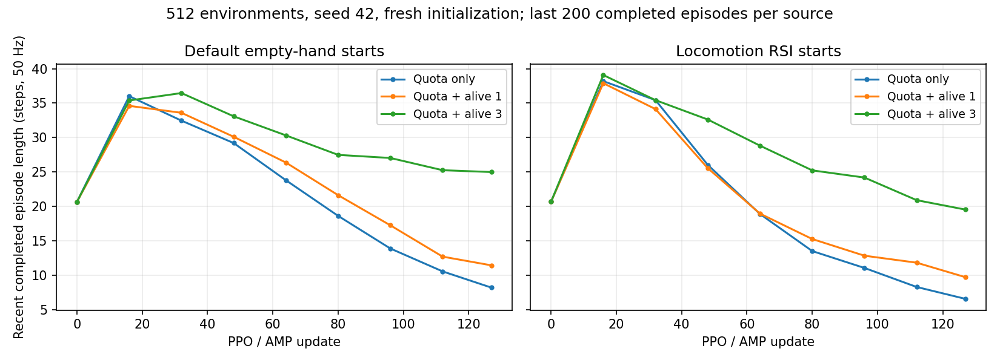

# Wall5 空手快速倾倒诊断与 revision27

2026-10-23。用户要求排查空手快速倾倒，修正后重启正式训练。确认了初始化来源的采样失衡，并实测发现仅修配额仍不足。最终保留原力矩/动作惩罚和物理配置，加入持续存活反馈；同规模短训的空手末段回合长度约提高3倍。这个结果只支持早期退化得到缓解，尚不能证明站立、行走或地面拾箱收敛。

## 同初态回放

固定rev26 model13200与已能行走的rev22 model6400，64个相同初态（32默认站姿、32 loco RSI），seed73，诊断统一关闭推扰与yaw课程，使用均值动作。旧模型只迁移网络权重作对照，不恢复旧训练环境。

| 策略/控制 | 默认站姿平均首回合 | loco RSI平均首回合 | 跑满20s |
|---|---:|---:|---:|
| 当前model13200 | 0.176s | 0.156s | 0/64 |
| 旧rev22 model6400 | 11.017s | 10.642s | 32/64 |
| 一直保持reset关节角目标 | 1.069s | 1.025s | 0/64 |
| 当前模型关闭动作延迟 | 0.168s | 0.141s | 0/64 |

当前策略64例均因tipped结束，没有头高或骨盆高度终止。旧策略在相同当前碰撞/PD/reset下更稳定，说明不是当前构型必然无法站立。当前学出的动作会加速失稳；关闭延迟未改善，因此没有改PD、延迟或放宽终止。

进一步冻结同一个rev26 AMP判别器，使用真实终止前AMP窗口比较完整混合回报。gamma=.99时，current/rev22平均混合回报为 **0.3325/7.1029**，共同短前缀为0.3325/0.4939；平均style为0.3544/0.7427。AMP确实更认可旧稳定策略。原始task回报虽然对旧策略较低，但**不能据此说完整PPO目标偏好倾倒**。成熟判别器能给稳定策略高分，也不保证从随机策略开始容易学到这种行为。

## 确认的问题和修复

旧训练reset概率约20%默认、53.33% loco RSI、13.33% pickup、13.33% hold，实际控制步却只有4.38%来自空手，pickup30.30%、hold65.32%。每次结束重新抽技能，短命空手环境很快迁入持箱长回合；控制步占比受“reset概率×平均回合长度”影响。该偏置是确认的放大机制；最早退化发生在rev23，先于随机hybrid reset，因此不是全部历史问题的单一解释。

revision27按全局env_id固定四类初始化来源，4096环境为819默认、2185 loco RSI、546 pickup、546 hold；空手控制步固定为3004/4096=73.34%。参考片段、连续帧、关节/速度扰动及箱子位置仍每回合重采样。来源只决定初始化，不限制回合内找箱、拾箱、持箱，也不进入actor/critic。default transition日志同时修正为step前取标签，避免终止步归到新回合。采样读取实际cfg，checkpoint记录同一配置与revision27。

仅修配额的512环境128更新短训仍退化，末段默认/loco只有8.185/6.55步；没有直接将它用于正式训练。新增标准IsaacLab `is_alive`作为持续反馈，最终weight=3.0：正常步和纯timeout步raw奖励+0.06，进入0.75×task后为+0.045；真实失败步为0。它没有额外头高、姿态或技能门控，不直接限制下蹲，也没有恢复−50跌倒惩罚。

加入该项是基于短训的工程调参，不是声称修正了某个错误的力矩公式。探索初期，512环境四类来源混合统计中，动作变化、力矩、加速度惩罚合计约−0.108/步，walk/carryup/standup正项合计约+0.008；AMP早期style下降后反馈不足。此统计不是空手专属常量，更不是必须逐项抵消的固定成本。生存项提供不随判别器变化的信号，也可能奖励原地存活；是否会走近并拾箱仍需后续验证。

## 同规模短训与失败保留

三次均为512环境、seed42、128次更新，从零初始化。下表为最后更新时、每组最近200个已结束回合的平均步数；50步=1秒。

| 候选 | 默认站姿 | loco RSI | 判定 |
|---|---:|---:|---|
| 仅固定配额 | 8.185 | 6.550 | 管线通过，行为仍退化，未正式启动 |
| 固定配额＋alive weight1 | 11.425 | 9.700 | 未达两组都超过基线2倍的断言，FAIL保留 |
| 固定配额＋alive weight3 | 24.985 | 19.525 | 两组约3倍，通过同一断言 |

完整曲线仍有从早期峰值下降的趋势，改善是缓解退化，不是短训已经站稳。没有因为总奖励增加就宣布成功；没有放宽行为断言，也没有再尝试weight6。



保留[仅配额基线](quota_only/smoke.json)、[weight1失败回执](alive_weight1/receipt_1.json)、[weight1完整控制台日志](alive_weight1/validate.log)、[最终128更新](pilot_updates.json)。生产只改四个wall5文件；75个其他原启动来源哈希保持。原碰撞/自碰撞、三pickup全片段、最终FK接地、配对箱子/平台、动作延迟、力矩及其他既有奖励、roll0.5、actor深度/本体、critic123、全部配对帧辅助监督均保持。固定来源配额不再声称与PhysHSI每次随机抽来源逐行相同。

证据：[同初态诊断](diagnosis.json)、[冻结AMP混合回报](mixed_diagnosis.json)、[最小源码改动](source_changes.patch)、[范围核对](scope_check.json)、[专家审查](expert_brief.md)。`Reset/*`是reset事件比例，`Sampling/*`是训练控制步配额，loco包含默认站姿。正式启动与验证快照见下文。

## 验证与正式训练快照

CPU 9项通过，包含固定配额/partial reset、配置覆盖、终止步归属、延迟及生存奖励正常/失败/timeout/并发失败边界。512环境5120次reset接地检查通过，最低脚凸包离地0.005000m，三pickup、配对支撑台、最终q填充延迟缓存及partial reset保持。

最终512环境fresh 128次PPO/AMP更新均有限，实际四类控制步配额始终[102, 273, 69, 68]；actor、critic、CNN、pose head均更新，保存恢复输出一致，拒绝revision26完整恢复。weight1没有通过行为断言，原始FAIL回执和日志已完整保留；weight3通过相同断言，没有降低标准。

2026-10-23T12:54:05.364864+09:00：旧PID1796143已退出，日志最后第13800轮；最后保存model_13800.pt，旧模型及日志全部保留。新PID **2143205**，4096环境，seed42，40000轮，**从零初始化，无resume/warm-start**。核验到第**100**轮，近10轮平均**3.876s/轮**、最慢3.900s。

新训练Sampling/loco（含default）=0.7334，default=0.2000，pickup=0.1333，hold=0.1333。最近25轮按累计已结束回合反算的各组平均步数约为{"loco": 41.059700997735575, "pickup": 30.52004316121349, "hold": 33.64826234435539}，仅作早期训练诊断。

Run：`/home/cao/perceptual_ball/logs/rsl_rl/g1_carrybox_depth/walled5/2026-10-23_12-44-38_wall5_v27_stability_fresh_20261023_124434`

```bash
tail -f /home/cao/perceptual_ball/logs/rsl_rl/g1_carrybox_depth/walled5/launch_wall5_v27_stability_fresh_20261023_124434.log
```

新模型revision27/schema2，首轮policy/AMP及优化器有限，优化器step20、AMP统计计数61440符合fresh初始化，critic123、AMP60×10、完整15clips、自碰撞及roll0.5契约一致。当前确认正式训练持续推进和采样修复；尚未完成新正式checkpoint的独立行走/抓取评估。

[短测](smoke.json)、[正式启动](launch.json)、[100轮以上快照](snapshot.json)、[最终测试回执](receipts.json)、[工件校验](artifact_validation.json)。
