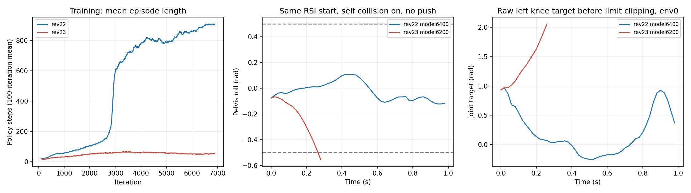

# Wall5 revision23：为什么训练约7000轮仍不会稳定走路

2026-10-22，只读排查。**本轮是训练配方的明显退化，不能解释为单纯还没训够。最需要修的是自碰撞开启后的接触计分，以及接近箱子到抓取之间的奖励过渡。** 本次没有修改生产代码、模型、数据或正式训练进程；没有宣称已经修复收敛。

## 已确认的事实

本轮revision23从零开始，未继承revision22的走路权重。比较相近训练阶段，前100轮滑动平均的`Mean episode length`在6400轮时，revision22约886.8步，而revision23约49.9步。不是此前所有训练轮数叠加在同一个策略上。

revision23日志快照到6978轮；末100轮整体平均回合52.9步。`Skill/loco_mean_steps`是训练以来累计统计，约32.9步，不能当作最近回合均值；6000–6400轮由累计计数差分反推的空手回合约33.8步，而revision22同窗约868.7步（日志打印与逐迭代均值使差分有近似误差）。

## 独立回放对照

独立32环境，固定seed42、均值动作；取其中24个loco起点的首个完整回合，最多1000步/20秒。其余技能不混入结果，不按重置次数重复抽样。自碰撞开关只在诊断进程生效；正式训练一直保持原配置。新版使用与录像相同的`model_6200.pt`，旧版使用`model_6400.pt`。旧策略仅用于明确标注的网络权重对照，严格匹配网络参数形状，并记录全部环境契约差异；不是宣称旧checkpoint与新版完整训练恢复兼容。

| 策略与诊断设置 | 平均首回合时长 | 满20秒 | 倾倒终止 |
|---|---:|---:|---:|
| 新版6200，原自碰撞/原推扰 | 0.739s | 0/24 | 24/24 |
| 新版6200，自碰撞开/推扰关 | 0.736s | 0/24 | 24/24 |
| 新版6200，自碰撞关/推扰关 | 0.735s | 0/24 | 24/24 |
| 旧版6400，新场景自碰撞开/推扰关 | 15.906s | 18/24 | 6/24 |
| 旧版6400，新场景自碰撞关/推扰关 | 17.875s | 20/24 | 3/24，另1次骨盆低高度 |

两组新版带推扰回放的24个首回合均在第一次推扰前结束。故**这次开场倾倒不是推扰当场触发，也不是关闭自碰撞就能恢复的机械卡死**。这不排除它们在训练过程中改变了学习难度。旧策略在新物理中仍能走近箱子，说明相同G1控制/RSI并非根本无法行走。

保持reset关节角而不跟随策略的辅助基线，开启/关闭自碰撞分别平均40.875/41.083步结束。RSI带运动速度，冻结关节不能当作站立控制器或证明reset有bug。

## 奖励与接触的具体问题

1. **自碰撞改变了旧接触惩罚的含义。** `WalledRewardsCfg.undesired_contacts`仍使用所有髋/膝的`net_forces_w_history`，阈值1N、每个触发连杆权重−1。开启自碰撞后，自身连杆接触也进入这一统计。旧策略在新场景中该项平均每步−0.01492；关闭自碰撞后约−0.0000149。两者轨迹会分叉，不能把差额严格当作逐状态分解，但代码路径与物理接触读回都确认了自接触计分。env0旧策略记录到手↔髋及骨盆↔左髋roll的接触，后者单次峰值约4.15kN。此前只检查默认姿态和短复位，漏掉了动态走路接触；尚需区分结构凸包重叠与真实身体碰撞，不能直接把所有自碰撞过滤掉。

2. **新版拿掉近箱站立收益，但抓取前的奖励过渡不足。** 原近箱walk固定1.5被删除，新版站位最高只有0.2，即每控制步0.004；速度项却仍可给约1.5，即每步0.03。该速度项不要求姿态稳定，短暂冲向箱子、随后侧倒也会拿分。新策略无推扰回放的walk平均+0.02239/步，carryup仅+0.00038/步；standup为0。到箱边后能否平稳调整、下蹲伸手，尚没有形成足够可学的连续奖励。旧策略站得过近会被新版crowding惩罚，这是有意限制旧版行为，不能简单把旧策略负奖励解释成所有新版奖励都错，也不应恢复“靠近就永久满分”的旧问题。

3. **动作轨迹显示是策略主动失稳。** 同一个env0起点，旧/新模型初始化位置、速度与关节姿态相同；新版在0.28秒内roll由−0.076变成−0.554rad而终止，骨盆高度由0.777降到0.630m。左膝目标从约0.93快速增至2.06rad，实际膝角到约1.86rad；该首回合未记录到超过10N的自接触。旧模型在相同新物理场景的该起点跑满20秒。这是错误的闭环动作趋势，不是只把roll阈值放宽就等于学会走路。

4. **没有证据把当前问题归给低学习率或辅助损失爆炸。** 两版同期PPO自适应学习率都约1e−4数量级；当前box-position损失约0.015，不是历史上6以上的爆炸。完整三段pickup AMP、自碰撞和奖励在本次一起改变，因此完整AMP对训练退化的独立贡献仍未隔离；不能仅凭这次回放断言“都是AMP导致”。

这里报告的reward分量都已乘0.02s、尚未乘task混合系数0.75，不含AMP；本诊断的style分数按各自checkpoint判别器计算，且为均值动作首回合的动作前窗口，不能拿它们跨判别器排序或与正式训练采样动作的transition日志直接比较。

## 处理顺序与当前状态

先审计走路时的自接触对及其计分，将结构碰撞问题和任务碰撞惩罚分开；再补足稳定接近、合理站位到伸手的奖励过渡，避免奖励倾倒过程产生的速度，也避免近箱站着就拿满分。之后先用短训检查行走不退化，再决定长训；兼容时用已学会走路的权重作初始化可以节省重复学习，但不能把warm-start当作奖励修复。

上次revision23验收只证明短训、保存恢复和正式启动正常，没有证明走路和拾箱配方有效。缺少动态接触与行走退化验收是验证不足，已经在本次证据中明确记录。

本次8组诊断运行、模型/源码hash与正式进程身份检查通过，全部192个空手首回合都有终止记录，无右删失。它们是有限seed与起点的工程对照，不是总体成功率或重新训练的因果结论。正式训练PID1588407未被停止或重启；状态快照见[process_status.json](process_status.json)。

证据：[训练趋势](training_trends.json)、[八组汇总](summary.json)、[自碰撞开完整轨迹](on.json)、[自碰撞关完整轨迹](off.json)、[执行回执](receipts.json)、[模型与源码身份](selection.json)。

复现脚本为本目录`check.sh`；原记录应保留，重复诊断应复制到新目录，不覆盖现有证据。
